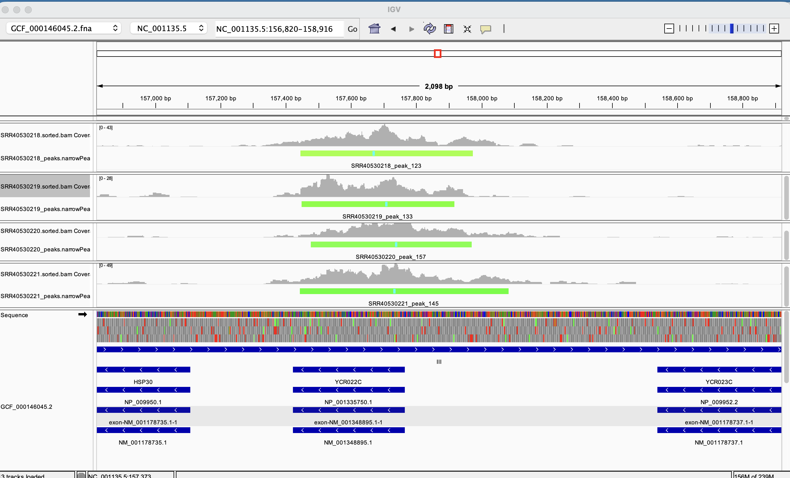
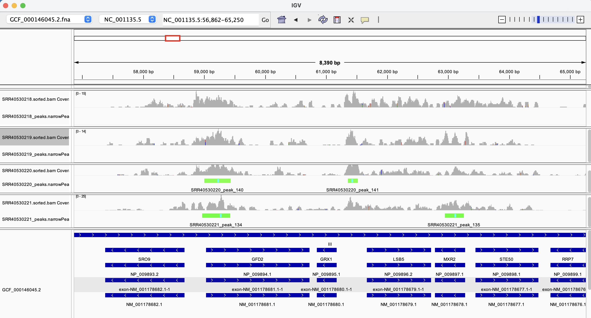
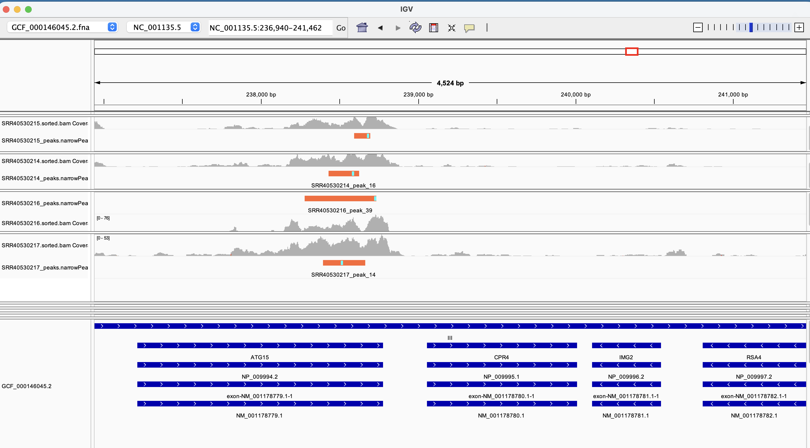
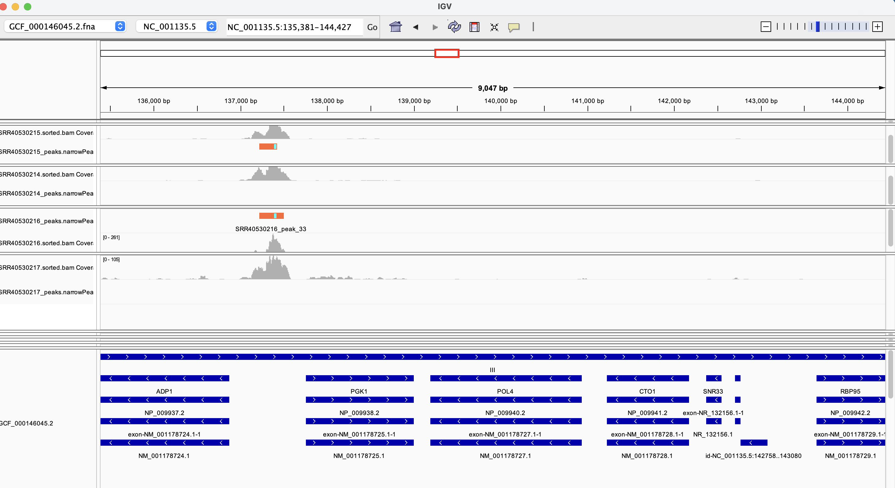
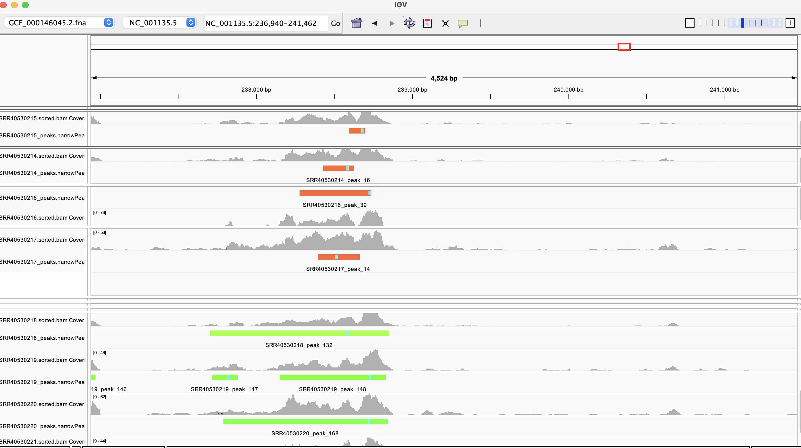
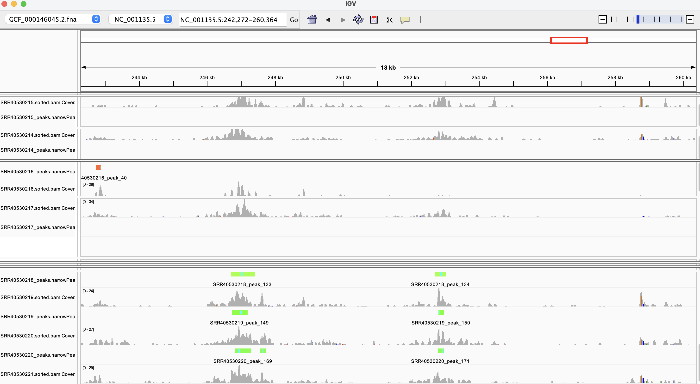

## Week 10 hw

| Feature | Description |
|---|---|
| BioProject | PRJNA1523976 |
| Assay | Paired-end ATAC-seq |
| Organism | *Saccharomyces cerevisiae* (budding yeast) |
| Experiment | Examines how removing Sth1 from the nucleus affects chromatin accessibility, comparing four DMSO baseline samples with four samples treated with rapamycin for one hour. |
| Total samples | 8 biological replicates: 4 per group |
| Control | 0-hour samples treated with DMSO |
| Condition | 1-hour samples treated with rapamycin |
| Goal | Identify accessible chromatin regions and assess agreement among replicates |

The workflow downloads reads, aligns them to the yeast reference genome, filters alignments, and calls accessible chromatin peaks with MACS3. GNU Parallel processes samples concurrently. An additional analysis calls peaks in each condition sample relative to pooled control alignments. Peak counts and visual comparisons in IGV will be used to assess agreement among replicates.

### Set up the environment
The supplied `pixi.toml` declares the required packages and version constraints. From the `week10_hw` directory, install and activate the environment:
```bash
pixi install
pixi shell
```

If you want to use bioinfo env instead, make sure you have GNU parallel install:
```bash
pixi add parallel
pixi add macs3
```

To run alignment and peak calling for one sample:
```bash
make all SRR_ID=SRR40530218
```

Before running all samples, lets make a deisgn.csv. Match on your intended control and condition:
```bash
make design-csv PROJECT=PRJNA1523976 MATCH='^sth1_(0hr|1hr)_' STRATEGY=ATAC-seq
```

To run aligment and peak calling for all samples:
```bash
make batch JOBS=10 THREADS=1
```
this runs all jobs in parallel and gives each job one thread

To run aligment and peak calling for control (background) samples:
```bash
make background JOBS=4 THREADS=1
```

To run aligment and peak calling for the condition samples:
```bash
make peaks JOBS=4 THREADS=1
```

### Questions to answer
1. How many peaks were called in each sample?
After running:
```bash
make background JOBS=4 THREADS=1
make peaks JOBS=4 THREADS=1
```

I ran:
```bash
# Independent peak counts from make batch
wc -l data/background/*/*_peaks.narrowPeak

# Background-relative condition counts from make peaks
wc -l data/condition/*/*_peaks.narrowPeak
```

| Run accession | Sample | Group | Peaks |
|---|---|---|---:|
| SRR40530218 | sth1_0hr_rep4 | DMSO control | 1,295 |
| SRR40530219 | sth1_0hr_rep3 | DMSO control | 1,371 |
| SRR40530220 | sth1_0hr_rep2 | DMSO control | 1,554 |
| SRR40530221 | sth1_0hr_rep1 | DMSO control | 1,408 |

| Run accession | Sample | Group | Peaks |
|---|---|---|---:|
| SRR40530214 | sth1_1hr_rep4 | Rapamycin condition | 1,318 |
| SRR40530215 | sth1_1hr_rep3 | Rapamycin condition | 1,326 |
| SRR40530216 | sth1_1hr_rep2 | Rapamycin condition | 1,404 |
| SRR40530217 | sth1_1hr_rep1 | Rapamycin condition | 1,378 |


2. How consistent are the peak calls within replicates? Show one region where the replicates agree and one region where they do not.

a) 
At NC_001135.5:156,820–158,916, all four DMSO control replicates show overlapping peak calls, demonstrating consistent detection of an accessible chromatin region. Peak boundaries vary slightly among replicates. The peak locations do overlap with the YCR022C gene in the reverse strand, NC_001135.5:157421-157765 (-)


b) 
Within NC_001135.5:56,862–65,250, peak calls vary among the four DMSO replicates. Near 59 kb, peaks are called in SRR40530220 and SRR40530221 but absent in SRR40530218 and SRR40530219. This illustrates disagreement in peak detection despite coverage in all four samples


c) 
The four rapamycin (condition) replicates show overlapping peaks within the ATG15 gene body near 238.5 kb on NC_001135.5. Peak widths and summit positions differ among replicates, but all detect accessibility in the same region.

d) 
Near 137.3 kb on NC_001135.5, peaks are called in two of the four rapamycin replicates, despite coverage enrichment in all four. This shows variation in peak detection. The peaks lie in the intergenic region between ADP1 and PGK1, consistent with a potential promoter region.

e) 
All samples both control and condition all fall under NC_001135.5:237702-238850 though control peaks appear more broad than condition

f) 
Around NC_001135.5:242,272-260,364, we see that only control samples have a peak while condition samples do not. Upon further inspection, peak seen in control sample overlaps with SOL2 NC_001135.5:246963-247910 (+)

### Acknowledgments

This project uses [GNU Parallel](https://gnu.org) for parallel command execution. Please cite the tool as follows if you build upon this work:

> O. Tange (2011): GNU Parallel - The Command-Line Power Tool, *;login: The USENIX Magazine*, February 2011:42-47. DOI: [10.5281/zenodo.16303](https://doi.org).

**Side note**: Alternatively, you could pay 20k EUR to me!