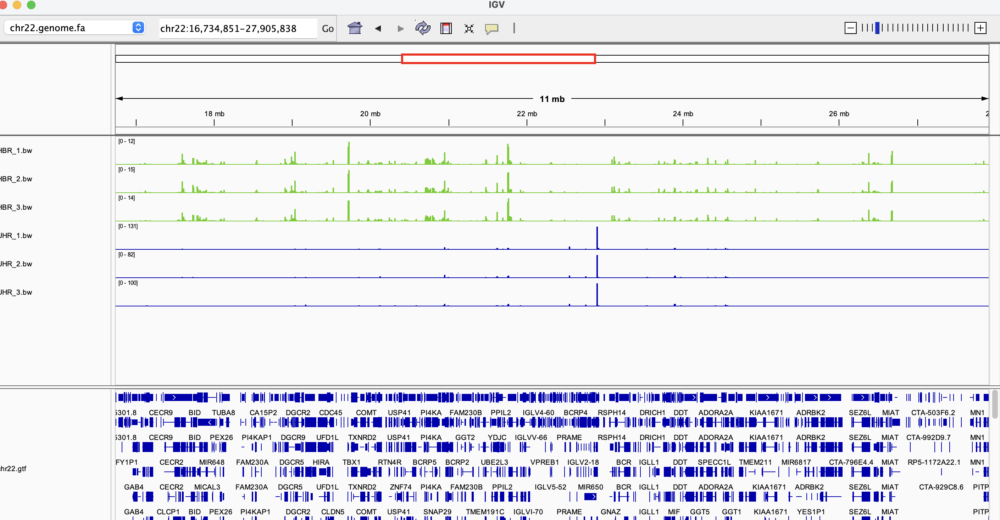
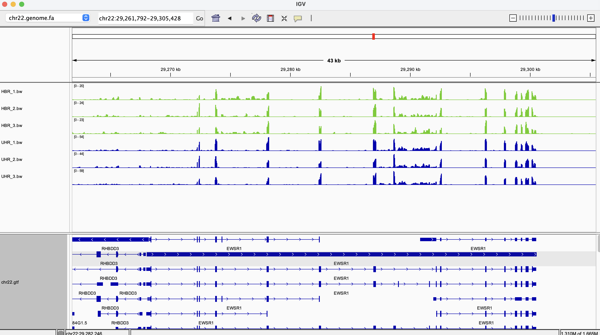

## Week 11: Evaluate gene expression

The aim of this week’s assignment is to compare RNA-seq coverage on chromosome 22 between two types of human reference RNA samples:

- **HBR (Human Brain Reference):** RNA isolated from human brain tissue
- **UHR (Universal Human Reference):** RNA from a mixture of 10 cancer cell lines

### Special thanks

The Makefile and design.csv were obtained from the Biostar Handbook, written by Dr. Istvan Albert

### Env setup, generate index, and alignment

```bash
# env setup
pixi add hisat2 subread deeptools

# generate index and alignment for all samples
make batch
```

### The questions
1. Look at a wide region (millions of bases wide). How are the two sample types different?

Overall, they appear different at a high level. When viewed more closely, different regions show stronger expression in HBR, while others show stronger expression in UHR.

2. Navigate across the genome. How consistent are the replicates?
The replicates appear to be highly consistent with each other. They generally show peaks with similar coverage at similar positions, though the peak intensities sometimes differ.

3. Find a gene that is not expressed in any of the samples.

The OR11G1 gene appears to not have any detectable expression in any of the 6 samples. No RNA-seq coverage was observed across the gene

4. Find a gene that is very strongly expressed in all samples. What is its coverage?

The EWSR1 gene appears to be highliy expressed

5. Can you identify the transcripts that are expressed? Sometimes you can only exclude some candidates.


6. Can you find a gene/transcript where the expression is clearly different between the two sample types? What is the fold change?

7. Is the transcript upregulated or downregulated?

8. How certain are you that it is not a random fluctuation? Why?