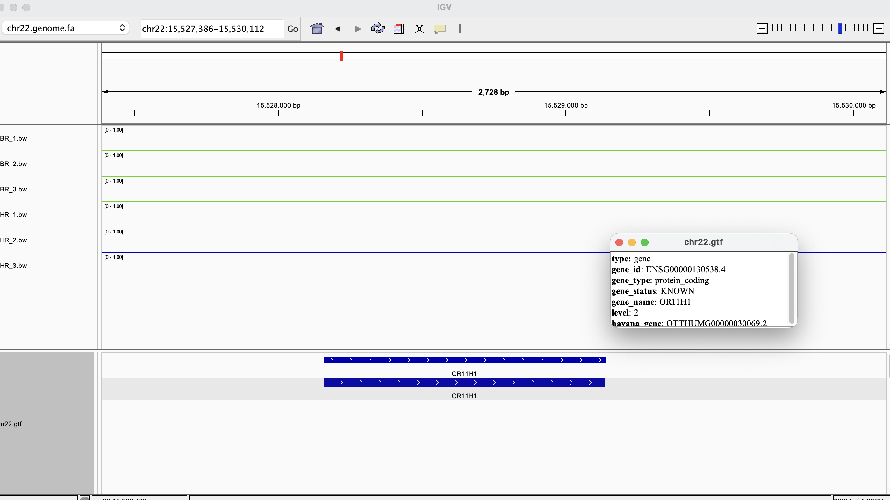
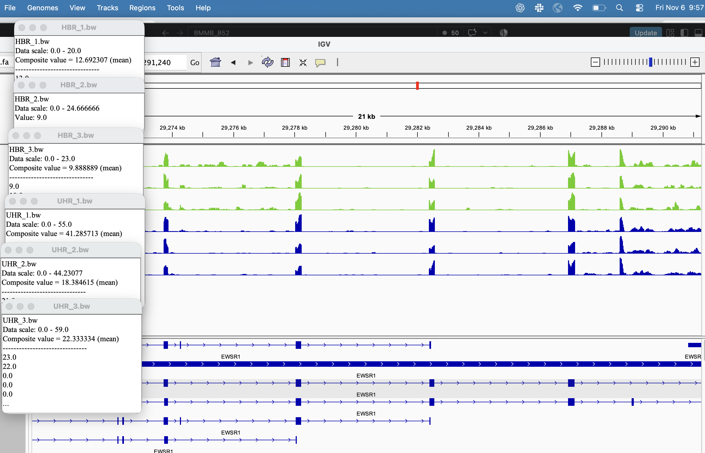
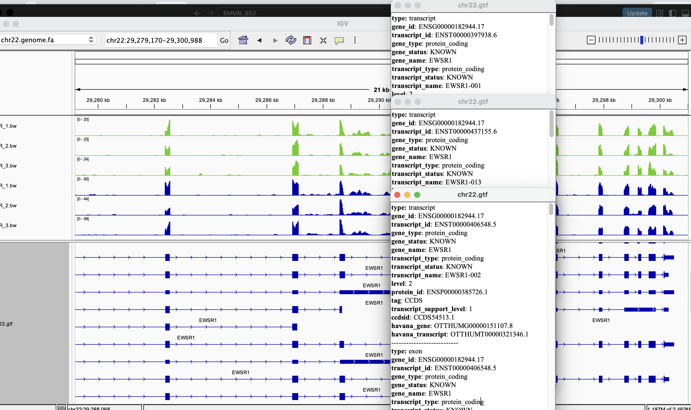
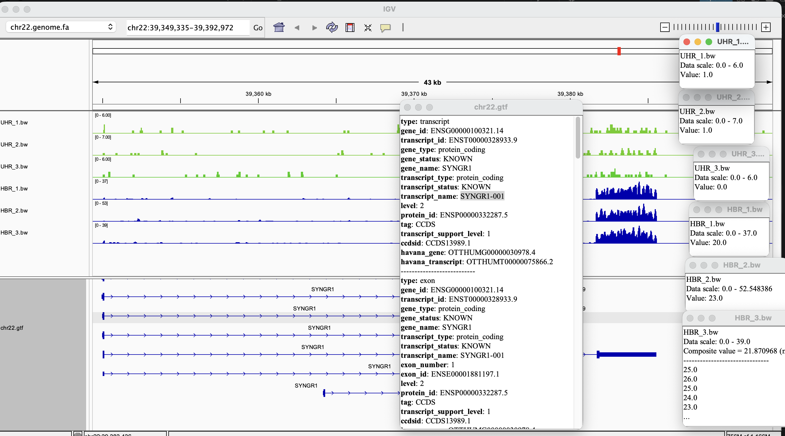

## Week 11: Evaluate gene expression

The aim of this week’s assignment is to compare RNA-seq coverage on chromosome 22 between two types of human reference RNA samples:

- **HBR (Human Brain Reference):** RNA isolated from human brain tissue
- **UHR (Universal Human Reference):** RNA from a mixture of 10 cancer cell lines

### Special thanks

The Makefile and design.csv were obtained from the Biostar Handbook, written by Dr. Istvan Albert

### Env setup, generate index, and alignment

```bash
# env setup
pixi add hisat2 subread deeptools

# generate index and alignment for all samples
make batch
```

### The questions
1.Look at a wide region (millions of bases wide). How are the two sample types different?


Overall, they appear somewhat similar at a high level though when viewed closely different regions show stronger expression in HBR, while others show stronger expression in UHR.

2.Navigate across the genome. How consistent are the replicates?

The replicates appear to be highly consistent with each other. They generally show peaks with similar coverage at similar positions, though the peak intensities sometimes differ.

3.Find a gene that is not expressed in any of the samples.



The OR11G1 gene appears to not have any detectable expression in any of the 6 samples. No RNA-seq coverage was observed across the gene

4.Find a gene that is very strongly expressed in all samples. What is its coverage?




The EWSR1 gene around chr22:29,261,792-29,305,428 appears to show strong expression with substantial RNA-seq coverage and peaks across all 6 samples. At one inspected position within EWSR1, the exon coverage appear to be around 10-12 for HBR and 20-40 for UHR

5.Can you identify the transcripts that are expressed? Sometimes you can only exclude some candidates.



Not for EWSR1 as the transcipts I find all covered exons shared with one another. Thus, I cannot tell which transcript is expressed because several transcripts match the observed coverage.
When looking at 

6.Can you find a gene/transcript where the expression is clearly different between the two sample types? What is the fold change?



SYNGR1 gene generally showed higher expression in HBR than UHR across all three replicates. The mean assigned read count was 874 in HBR and 48 in UHR, corresponding to an approximately 18.2-fold increase in HBR using unnormalized counts.
In a specific SYNGR1-001 transcript, the HBR value is much higher than UBR, about 23x fold

7.Is the transcript upregulated or downregulated?

The transcript is upregulated in HBR relative to UHR as all three HBR replicates showed substantially higher coverage than the UBR replicates

8.How certain are you that it is not a random fluctuation? Why?

Coverage over an exon unique to SYNGR1-001 is consistently higher in all three HBR replicates than in UHR, supporting a transcript-specific expression difference that is unlikely to be a random fluctuation.