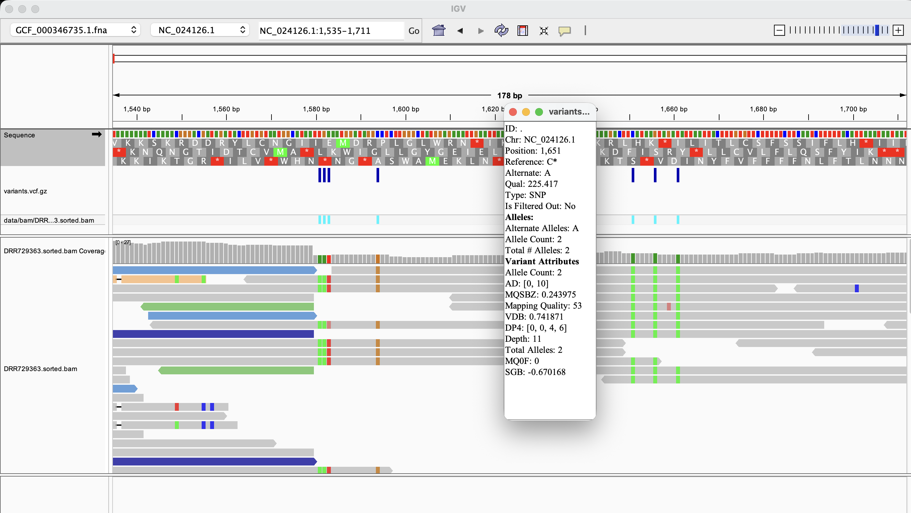
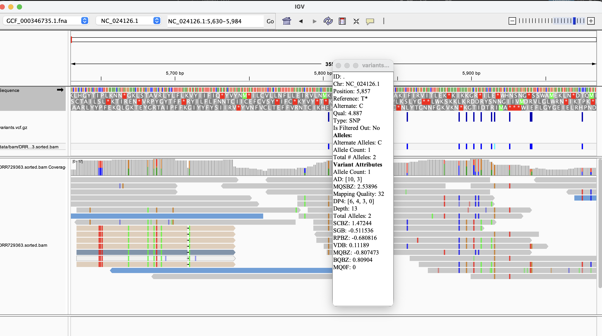
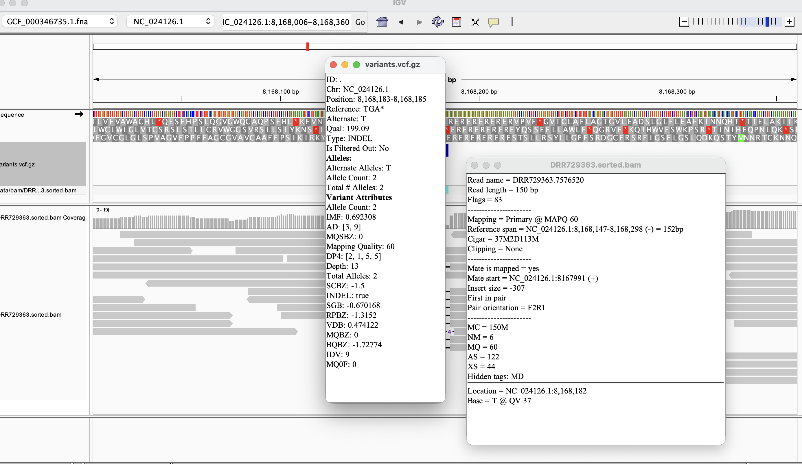

# Week 7: Call variants from a BAM file

This workflow aligns paired-end reads from `DRX709374` to the *Prunus mume* reference assembly `GCF_000346735.1_P.mume_V1.0` using BWA-MEM. SAMtools sorts and indexes the BAM and generates alignment and coverage reports. BCFtools calls SNPs and indels, normalizes and sorts the calls, and produces an indexed, compressed VCF and a variant statistics report. This workflow assumes paired-end short DNA reads
Target: at least 10× genome coverage The current results use `N=8000000` read pairs, corresponding to approximately 10.26× theoretical input coverage for paired 150 bp reads

The following command does the following:
1. Downloads and decompresses the reference genome into `data/fasta/` if it is missing.
2. Downloads the first 8 million read pairs into two FASTQ files in `data/fastq/`.
3. Aligns the reads to the reference, creates `data/bam/DRX709374.sorted.bam`, and indexes the BAM and reference for viewing in IGV. Alignment is rebuilt if the BAM is missing or its inputs are newer.
4. Saves mapping statistics and per-contig coverage in `data/reports/DRX709374.flagstat.txt` and `data/reports/DRX709374.coverage.tsv`.
5. Calls SNPs and indels from the BAM, normalizes the calls against the reference, and writes the sorted, compressed VCF to `data/vcf/variants.vcf.gz`, along with its index.
6. Saves variant counts and other VCF statistics in `data/reports/DRX709374.vcf.stats.txt`.

```bash
make all
```

All output of your file are in data/
```bash
├── Makefile
├── README.md
├── data
│   ├── bam
│   │   ├── DRR729363.sorted.bam
│   │   └── DRR729363.sorted.bam.bai
│   ├── fasta
│   │   ├── GCF_000346735.1.fna
│   │   ├── GCF_000346735.1.fna.amb
│   │   ├── GCF_000346735.1.fna.ann
│   │   ├── GCF_000346735.1.fna.bwt
│   │   ├── GCF_000346735.1.fna.fai
│   │   ├── GCF_000346735.1.fna.pac
│   │   └── GCF_000346735.1.fna.sa
│   ├── fastq
│   │   ├── DRR729363_1.fastq
│   │   └── DRR729363_2.fastq
│   ├── reports
│   │   ├── DRR729363.coverage.tsv
│   │   ├── DRR729363.flagstat.txt
│   │   └── DRR729363.vcf.stats.txt
│   └── vcf
│       ├── variants.vcf.gz
│       └── variants.vcf.gz.csi
└── images
```

## Questions to address

### How many variants were called?

BCFtools called 373,843 variant sites in sample DRR729363. These are unfiltered calls, so the total includes calls with weak evidence.

### What kinds of variants are present?

From data/reports/DRX709374.vcf.stats.txt, there are 335,702 SNP sites and 38,141 insertion/deletion sites (indels). The report also lists 2,179 multiallelic sites, which are included in these totals. No MNPs or other variant types were reported. The transition/transversion ratio is 1.65.

### Which calls look like true variants, and which look like errors? Are the calls supported by the alignments?

The SNP at NC_024126.1:1651 (C → A) looks like a true SNP. Its QUAL is 225.4, and all 10 reads counted in FORMAT/AD support the alternate allele, with 4 forward-strand and 6 reverse-strand reads. Thus, alignment support is strong


The SNP at NC_024126.1:5857 (T → C) is a possible error. Its QUAL is only 4.887, and only 3 of 13 reads support the alternate allele. All three alternate-supporting reads are on the forward strand. The alignment evidence therefore provides weak support, although it does not prove that the call is false.


Some other type of variant besides SNP such as a 2 base deletion (TGA -> T) can be observed at NC_024126.1:8,168,006-8,168,360. Its QUAL is 199.1, with 9 alternate-supporting reads, split 4 forward / 5 reverse. MAPQ = 60 indicating the aligner has high confidence in where this read maps.Base T @ QV 37, the anchor base has high base quality. ogether with the VCF’s nine alternate-supporting reads on both strands, this provides convincing alignment support for the deletion.


