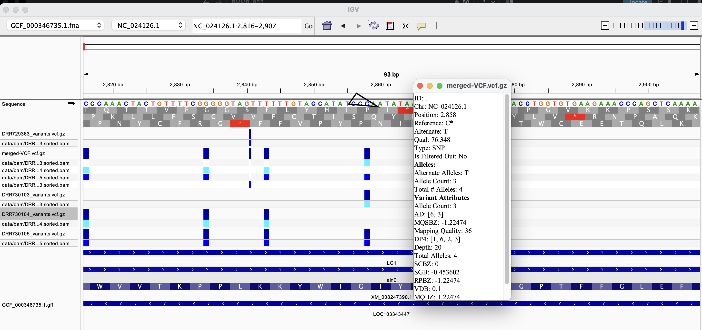
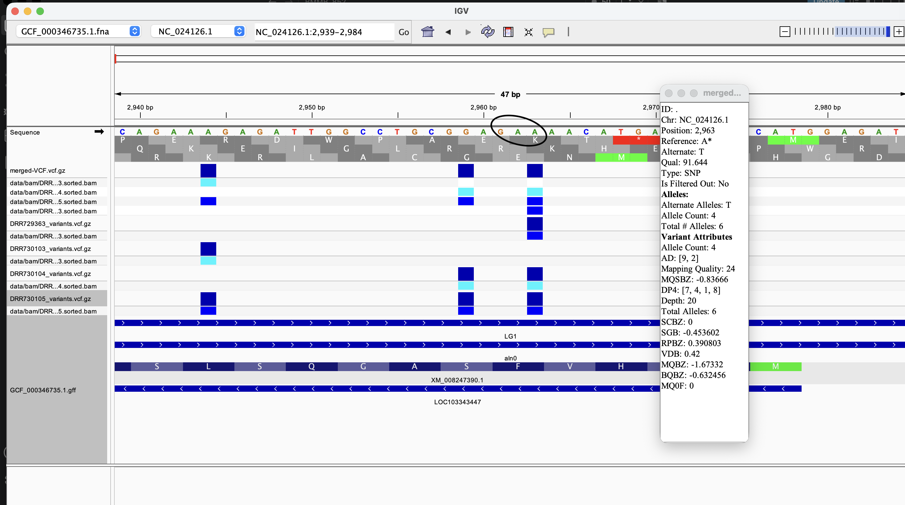
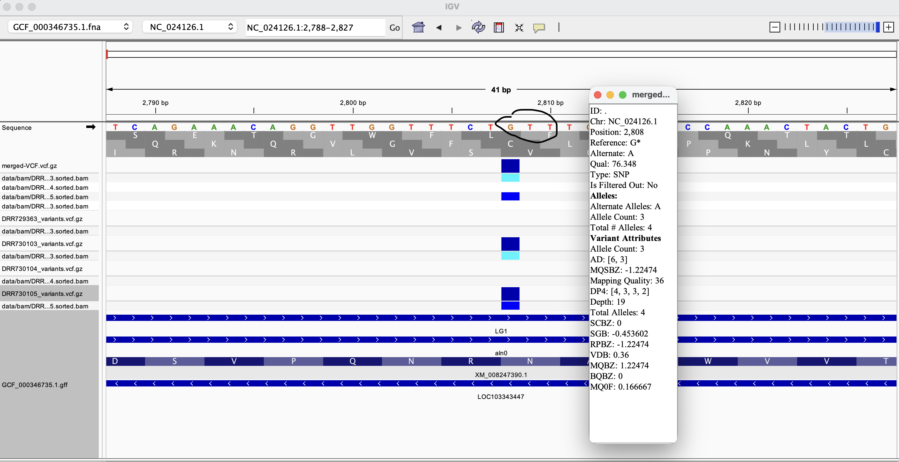

# Week 8: Predict variant effects

Variants that I chose to annotate are as follow:
DRR730103,DRR730104,DRR730105,and the default DRR729363

They are align to the reference genome: GCF_000346735.1

To generate alignment and variants. E.g::
```bash
make SRR_ID=DRR730105 variant-stats
```

To merge variant files. E.g:
```bash
bcftools merge --write-index -O z -o data/vcf/merged-VCF.vcf.gz \
data/vcf/DRR730103_variants.vcf.gz  \
data/vcf/DRR730104_variants.vcf.gz  \
data/vcf/DRR730105_variants.vcf.gz  \
data/vcf/DRR729363_variants.vcf.gz 
```

The variants that I chose to annotate by eye are as follows:
1. NC_024126.1:2858

At NC_024126.1:2858, the variant is C -> T in gene LOC103343447, transcript XM_008247390.1. This gene is on the minus strand, so the genomic triplet CCC -> CCT is reverse-complemented to obtain the coding codons GGG -> AGG. Using the standard nuclear genetic code for Prunus mume, GGG encodes glycine (G) and AGG encodes arginine (R). The predicted change is therefore Gly41Arg (G41R), a missense variant. 
Only DRR730103 and DRR730105 supports this change, missing calls from the other two variants. Allele Count: 3 / Total Alleles: 4. This is 75% among called alleles, with two samples missing.

2. NC_024126.1:2,963

At NC_024126.1:2963, the A -> T variant changes the genomic triplet GAA -> GAT. Because transcript XM_008247390.1 is on the minus strand, the corresponding coding DNA codon changes from TTC -> ATC. Using the standard nuclear genetic code, this produces phenylalanine(F) -> isoleucine(I) a missense variant.
Only DRR729363, DRR730104 and DRR730105 supports this change, missing calls from the other variant. Allele Count: 4 / Total Alleles: 6. DRR730104 contributes two T copies, the other two contributes 1 each

3. NC_024126.1:2808

At NC_024126.1:2808, the G -> A variant changes the genomic triplet GTT→ATT. Because transcript XM_008247390.1 of gene LOC103343447 is on the minus strand, the coding codon changes from AAC -> AAT. Both codons encode asparagine (N) using the standard nuclear genetic code. Therefore, this is a synonymous variant. DRR730103 contributing two alternate A copies. DRR730105 is G/A (0/1), contributing one alternate A copy and one reference G copy. DRR730104 and DRR729363 have missing calls.
Therefore, the alternate allele count is 3, and the total number of called alleles is 4. Missing calls do not establish the reference genotype.

