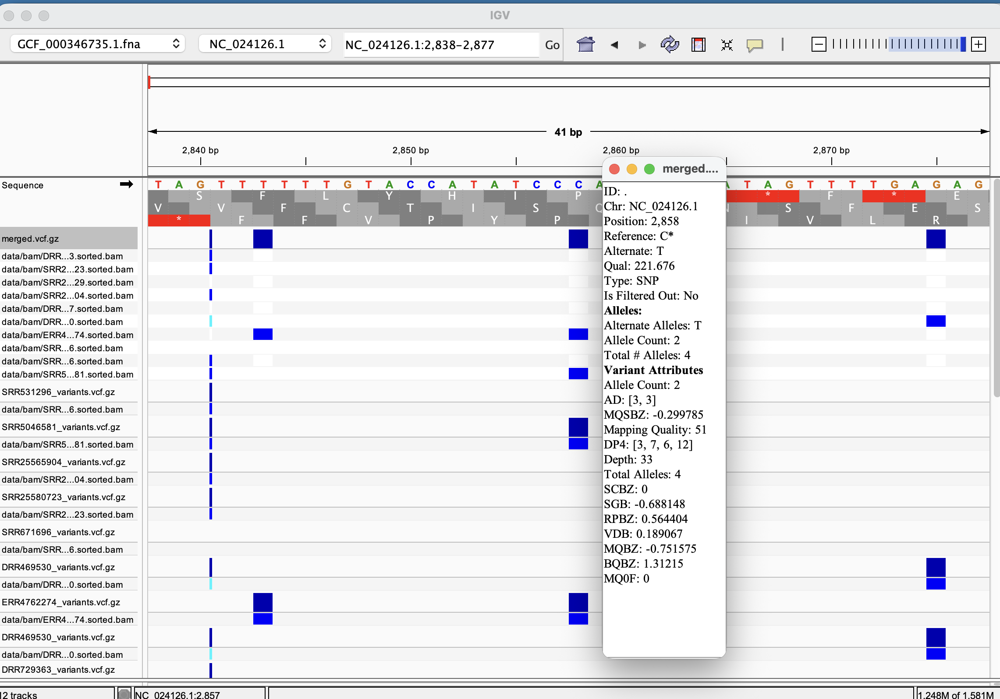
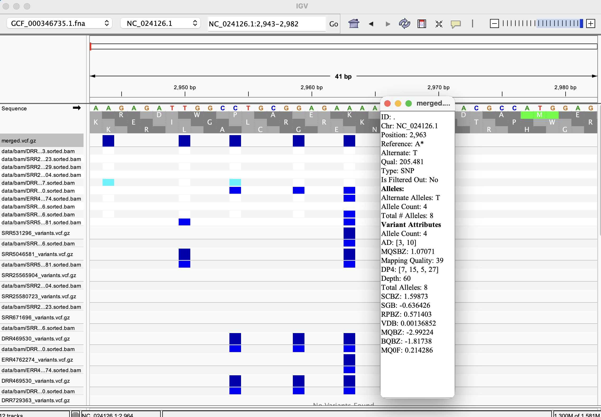

## Week 9: Create a workflow

This directory contains a workflow for downloading sequencing reads, aligning them to a reference genome, generating sorted and indexed BAM files, calling variants, and producing alignment and variant statistics. The reference genome is **GCF_000346735.1**. The `design.csv` file currently lists 10 samples.
The `batch` target reads `design.csv` and uses GNU Parallel to run the workflow for each sample.

### Set up the environment
The supplied `pixi.toml` declares the required packages and version constraints. From the `week9_hw` directory, install and activate the environment:
```bash
pixi install
pixi shell
```

If you want to use bioinfo env instead, make sure you have GNU parallel install:
```bash
pixi add parallel
```

### Run a single sample
To generate variant calls and variant statistics for one sample, run:
```bash
make SRR_ID=DRR729363 variant-stats
```

This also runs any prerequisite steps whose outputs are missing or outdated.

### Prepare the sample design
Before running a batch, ensure that `design.csv` uses the following format:
```csv
Accession,ReadPairs,BioProjectId
DRR729363,7800000,PRJDB28257
SRR25580723,7800000,PRJNA1003273
```

Each row specifies a run accession, the maximum number of read pairs to download, and its BioProject ID.
Note: You would probably want to change the ReadPairs value to something lower as running this full Makefile takes time


### Run the batch without merging VCFs
To process the samples listed in `design.csv`, run:
```bash
make batch JOBS=10 THREADS=1
```

`JOBS=10` allows up to 10 samples to run concurrently. GNU Parallel manages concurrency across samples, while each sample runs through a separate `make -j1` process. This keeps Make recipes sequential within each sample, and samples parallel. `THREADS=1` assigns one thread to each BWA alignment; it does not limit the entire workflow to one CPU thread per sample.

### Run the batch and merge VCFs
To process all samples and then merge their variant calls into a single indexed VCF, run:
```bash
make merge JOBS=10 THREADS=1
```

The merged VCF is written to `data/vcf/merged.vcf.gz`.

### Visualizing in IGV
I revisualized the variants i observed in previous week

1. NC_024126.1:2858

At NC_024126.1:2858, the variant is C -> T in gene LOC103343447, transcript XM_008247390.1. This gene is on the minus strand, so the genomic triplet CCC -> CCT is reverse-complemented to obtain the coding codons GGG -> AGG. It is a missense variant from G to R. However, only 2 samples agree on this variant and most samples do not display any variation here

2. NC_024126.1:2,963

At NC_024126.1:2963, the A -> T variant changes the genomic triplet GAA -> GAT. Because transcript XM_008247390.1 is on the minus strand, the corresponding coding DNA codon changes from TTC -> ATC. It is a missense variant from F to I. Unlike the previous variant, we observe greater support with half of our samples supporting this variant

### Acknowledgments

This project uses [GNU Parallel](https://gnu.org) for parallel command execution. Please cite the tool as follows if you build upon this work:

> O. Tange (2011): GNU Parallel - The Command-Line Power Tool, *;login: The USENIX Magazine*, February 2011:42-47. DOI: [10.5281/zenodo.16303](https://doi.org).

**Side note**: Alternatively, you could pay 20k EUR to me!
